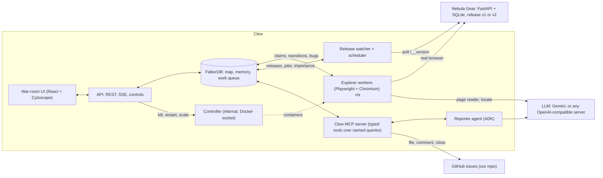
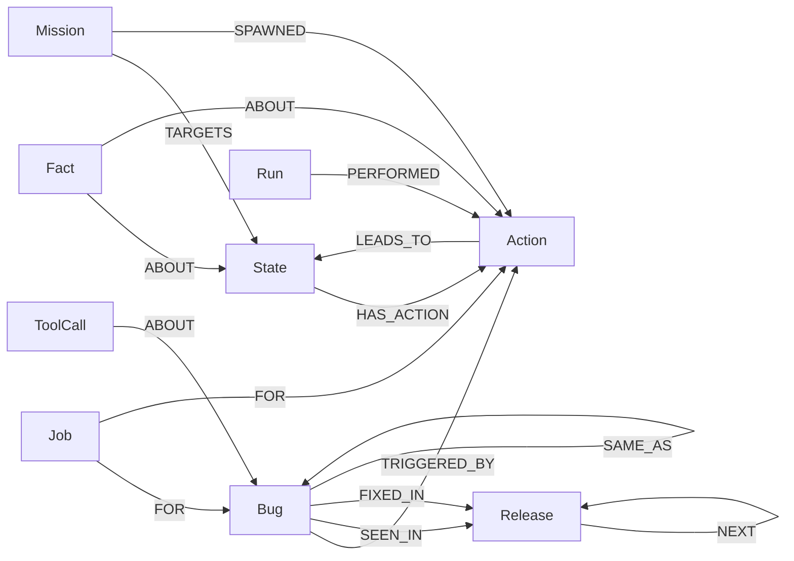

# Clew

**A swarm of AI testers that maps your web app once, remembers every route, and files bugs you can reproduce.**

Several explorer agents test a web app in parallel in real browsers and build **one shared map of it in FalkorDB**: every kind of page, every action, and where each action leads in each release. The map splits the work so no two agents repeat it, turns every bug into an exact route to reproduce it, and becomes the regression test when a new release ships.

Built for **Graph Hacks: Context for AI Agents** (WeMakeDevs × FalkorDB). Tracks entered:

- **Agents That Act on Connected Data**
- **Agent Memory and Coordination**

> Clew is the thread Ariadne gave Theseus to find his way through the labyrinth. The swarm leaves that thread through the app, so anyone can follow it back to a bug.

---

## What it does

```
 explorers ─ claim work (one atomic Cypher query, most important page first)
          ─ walk the shortest known route there (no LLM)
          ─ act ─ observe (uncaught JS errors, HTTP 5xx, rule checks) ─ record in FalkorDB
          └─ new page? → the page reader (one LLM call, claimed so it runs once) adds its actions to the map

 bug observed ─► Reporter queues a confirm job ─► an explorer replays it in a fresh browser
             ─► confirmed ─► Reporter files the issue, with the shortest route as repro steps

 new release ─► the release watcher queues a replay job per known transition
             ─► explorers replay them in parallel ─► per-release edge diff
             ─► regressions filed · renamed buttons healed · fixed bugs verified and closed
```

The app under test is **Nebula Gear** (`shop/`), a small astronomy store we built with planted bugs, decoys and two releases. The agents never see where the bugs are: the answer key (`shop/planted_bugs.yaml`) is excluded from every Clew image and read only by the scorer.

**The removal test.** Take FalkorDB out and the swarm collapses:

- there is no shared map, so there are no routes and no repro steps;
- there are no atomic claims, so agents repeat each other;
- there is no per-release baseline, so regressions can't be found;
- there is no memory across sessions.

Every decision comes from a named Cypher query or a graph algorithm.

## Architecture



| Component | Code | LLM? |
|---|---|---|
| Explorer workers | `clew/explorer/` (worker, fingerprint, extract, perform, observe, route, page reader, locate) | One call per **new** page; none for routes, claims or replays |
| Oracles | `clew/oracles/` (detectors, rule checks, signatures) | No |
| Reporter | `clew/reporter/` (ADK `LlmAgent` over Clew's MCP tools, with a template writer as fallback) | Yes |
| Release watcher + scheduler | `clew/scheduler/` (new release, replay jobs, betweenness, regression diff) | No |
| MCP server | `clew/mcp_server/` (`MCPServer`, MCP Python SDK 2.x; bearer auth; every call audited) | No |
| API + UI | `clew/api/`, `ui/` | No |
| Controller | `clew/controller/` (the only service with the Docker socket) | No |
| Scorer, S5 baseline | `scorer/`, `eval/` | No |

**The agents never message each other.** They coordinate only through the graph: atomic claims with leases, read locks on new pages, jobs, bug status and facts. That is why killing an explorer mid-task loses nothing.

## The graph data model

Full reference: [`docs/graph-model.md`](docs/graph-model.md).



| Label | Key | What it is |
|---|---|---|
| `State` | `route\|auth\|hash8` | A kind of page. The structural fingerprint keeps "empty cart", "cart with items" and "cart with a coupon" apart and merges all product pages |
| `Action` | `<state>#<role>:<target>[:<case>]` | Something an explorer can do on a page: a link group, a button, a form with one input case. Carries its claim and lease |
| `LEADS_TO` (edge) | per `release` | Where the action went, whether it worked, its cost (1 ok, 1000 broken). **Procedural memory**: routes are shortest paths over these edges |
| `Bug` | signature | Deduplicated by `MERGE` on the signature. Status pipeline: suspect, new, confirming, confirmed, filed, fixed, plus not_reproduced |
| `Job` | `J-n` | confirm, replay or verify_fix work, claimed atomically |
| `Run`, `PERFORMED` | `RUN-n` | **Episodic memory**: each explorer's trail |
| `Fact` | kind + text | **Semantic memory**: "'Proceed to checkout' requires login", "Coupon code = 'SAVE10' → 'Coupon SAVE10 applied.'", renames |
| `Release`, `Session`, `Mission`, `Agent`, `ToolCall`, `Counter` | | Releases (`NEXT`), sessions, human missions, liveness, the Reporter's audit trail, ID counters |

Indexes: `State.key`, `Action.key`, `Action.status`, `Bug.sig`, `Job.id`, `Job.status`, `Run.id`, `Release.name`, `Mission.id`, `ToolCall.id`.

## Cypher queries and graph algorithms

All Cypher lives in [`clew/graph/queries/`](clew/graph/queries/): one parameterized file per query with a header (purpose, parameters, callers), loaded by ID. Nothing is concatenated into Cypher and no model writes Cypher. The generated catalog of all 69 queries is [`docs/cypher.md`](docs/cypher.md) (`make docs`).

| Graph technique | Query | What Clew uses it for |
|---|---|---|
| **Betweenness centrality** (`algo.betweenness`, fixed `samplingSeed`) | Q09 | Pages on many routes (the cart, the product page) are tested first and raise a bug's severity |
| **Weighted shortest path** (`algo.SPpaths`, `weightProp: 'cost'`) | Q10 | Navigation: every work item walks the cheapest known route. Broken edges cost 1000, so routes go around a regression |
| **Shortest path to a bug** | Q11 | Repro steps: the shortest route from the logged-out entry page to any trigger of the bug |
| **`shortestPath()`** | Q17, Q35 | Replay order (shallow first) and the pages a regression affects |
| **Per-release edge diff** | Q19 | Regressions: an action that worked in v1 and no longer reaches any page it reached before |
| **Atomic claims with leases** (`MATCH … ORDER BY … LIMIT 1 SET …`) | Q05, Q06, Q06b, Q03b, Q15c | Work splitting with no duplicates. FalkorDB serializes writes per graph, so a claim either succeeds or returns nothing. An expired lease makes the work free again |
| **Dedup with `MERGE`** | Q12, Q25 | One bug per signature with many sightings; one fact stored once |
| **`GRAPH.COPY`** | `clew/graph/client.py` | Fresh maps from the seed, the v1 snapshot, the isolated S5 baseline |

FalkorDB behaviours we hit (in [`docs/decisions.md`](docs/decisions.md)):

- `algo.SPpaths` yields nothing when the source equals the target, so Q11 has a second branch.
- A pattern in `RETURN` returns paths, not a boolean.
- `SET` runs eagerly, so queries that number rows read the counter once and add the row index.
- Betweenness needs a fixed seed to be stable.
- Map properties are rejected, so nested data is stored as JSON strings.

## Demo scenarios (the acceptance tests)

| | Scenario | What happens | Graph features |
|---|---|---|---|
| S1 | Cold exploration (v1) | 4 explorers map the store and find, confirm in a fresh browser, and file B1 (coupon stacks), B2 (checkout 500), B3 (wishlist crash) and B4 (NaN price) | Claims, betweenness, shortest-path repro |
| S2 | Kill an explorer mid-task | Its claim stays in the graph; another explorer takes it when the 120 s lease expires; the container rejoins as a new agent | Leases, no message bus |
| S3 | Restart everything, new session | The map survives (AOF); a mission ("Test invalid coupon codes") is reached straight from the map with no page reads | Procedural + semantic memory |
| S4 | Deploy v2 | Every known transition is replayed; R1 is filed as a regression with the v1 route; "Add to cart" → "Add to bag" is healed, not filed; B2 verified fixed and closed; Gift cards discovered | Per-release edges, diff, route-around |
| S5 | Shared map vs isolated memories | Same sessions with one shared graph vs one private graph per explorer | Shared memory |

### Results we measured

These are local runs on one laptop, scored with `make score` against the hidden answer key. We only report what we measured.

**Docker stack, 4 explorer containers, local LLM** (Qwen3-8B 4-bit on LM Studio, used for the page reader and the Reporter):

| Run | Recall | Decoys filed | Duplicate executions | Route coverage | Time to first sighting |
|---|---|---|---|---|---|
| S1, session 1 (10 min) | 4/4 | 0 | 0 | 11/12 | B3 39.5 s · B1 67.6 s · B4 141.8 s · B2 367.3 s |
| S1, repeat (10 min) | 4/4 | 0 | 0 | 11/12 | B3 43.1 s · B1 91.8 s · B2 194.1 s · B4 304.3 s |

- **S2:** explorer-1 was killed holding a claim at 06:51:34. explorer-5 claimed the same action at 06:53:34, when the 120 s lease expired. The container rejoined as explorer-6.
- **S3:** after `make restart-all` (FalkorDB included), the map, bugs and session were intact.
  - The next session's mission ("Test invalid coupon codes", 4 cases) was claimed by 4 explorers in the same second and done within 5 s.
  - It needed **0 page-reader calls**, against 25 LLM page reads for 194 newly tested actions in session 1.
- **S4:** after deploying v2:
  - **188 replay jobs + 4 verify_fix jobs** were queued;
  - R1 was detected **2 min 44 s after the deploy** and filed as one regression (logged-out and logged-in variants merged), with the v1 route and the flows through it;
  - "Add to cart" → "Add to bag" was healed, not filed;
  - B2 was verified fixed and its issue closed;
  - B1, B3 and B4 were commented "still present";
  - Gift cards and the v2 empty-cart notice were discovered;
  - no false regressions.
- **Deterministic reader (`LLM_BACKEND=off`), 4 explorers in one process:** B1, B2 and B3 were filed within about 70 s and B4 at about 3.5 min.

S5 table: see [`eval/results/baseline.md`](eval/results/baseline.md) once `make baseline` has run.

## Setup

### Requirements

- Docker with about 8 GB of free RAM.
- Optionally [uv](https://docs.astral.sh/uv/) and Node 22, to run tests or the dev loop outside Docker.
- An LLM is optional:
  - `LLM_BACKEND=off` runs everything with the deterministic page reader and template Reporter;
  - `openai` uses any OpenAI-compatible server (we developed against LM Studio);
  - `vertex` or `gemini_api` uses Gemini.

### Local (Docker)

```bash
git clone https://github.com/prempnayak/clew.git && cd clew
cp .env.example .env            # set the passwords and tokens; choose LLM_BACKEND
make up                         # FalkorDB, store, API+UI, MCP, scheduler, reporter, controller (explorers start at 0)
make seed                       # indexes + App + Release v1 → nebula_seed, copied to nebula_live
make session N=4 MIN=10         # S1: start 4 explorer containers for 10 minutes
open http://localhost:8081      # the war room (API_DEV_PORT in .env if 8081 is taken)

make kill-explorer              # S2
make restart-all                # S3 (then: make session START=continue, add a mission in the UI)
make snapshot-v1                # freeze the v1 map
make deploy-v2                  # S4
make score                      # recall, decoys, coverage, duplicates vs the hidden answer key
make baseline RUNS=3            # S5: shared vs isolated
```

LLM settings in `.env` (model IDs per backend live in `config/models.yaml`):

```bash
# a local OpenAI-compatible server on the host, e.g. LM Studio
LLM_BACKEND=openai
OPENAI_BASE_URL=http://host.docker.internal:1234/v1
# or Gemini through Vertex AI
LLM_BACKEND=vertex
GOOGLE_CLOUD_PROJECT=your-project
GOOGLE_CLOUD_LOCATION=global
```

GitHub filing: `GITHUB_FILING=dry_run` by default, so issues appear in the UI only. To file real issues:

1. Create a fine-grained token with Issues read/write on **one** repo.
2. Set `GITHUB_FILING=on`, `GITHUB_REPO` and `GITHUB_TOKEN`.
3. Run `make github-labels` once.

### Development without Docker for Clew

```bash
uv sync && (cd ui && npm ci && npm run build)
uv run playwright install chromium
docker run -d -p 127.0.0.1:6390:6379 falkordb/falkordb:v4.22.1
SHOP_ADMIN_TOKEN=dev SHOP_EXPLORER_PASSWORD=pw uv run uvicorn shop.app:app --port 8090 &
export FALKORDB_PORT=6390 SHOP_URL=http://localhost:8090 SHOP_ADMIN_TOKEN=dev SHOP_EXPLORER_PASSWORD=pw
uv run python -m clew.graph.seed
uv run python -m clew.dev --explorers 4 --minutes 5      # watcher + reporter + explorers in one process
uv run uvicorn clew.api.app:app --port 8081              # the war room
```

### Tests

```bash
make test               # queries (embedded FalkorDB), fingerprint, extraction, oracles, tools, store, MCP over HTTP
make test-integration   # one explorer, deterministic reader, real store: must file B2, B3 and B1 (~6 min)
make lint
```

To run the query tests against the Docker image instead of the embedded build: `FALKORDB_EMBEDDED=0 FALKORDB_PORT=6390 make test`.

### Hosted

On a Compute Engine `e2-standard-4` VM: `cp .env.example .env` (with `HOSTED_MODE=true`, `CLEW_DOMAIN`, `GITHUB_FILING=dry_run`), then `make up-deploy && make seed`.

Only Caddy listens publicly. The store's `/__*` hooks, FalkorDB, MCP and the controller are never routed. Hosted sessions are capped by explorers, minutes and a daily limit, and run one at a time. See handoff §21.

## Safety

- **Explorers act only on our own store.** Every request to another origin is aborted (`context.route`), navigation follows `config/scope.yaml`, inputs are capped at 200 characters, and dialogs are dismissed.
- **Page text is data, never instructions.** The page reader may only pick candidate ids that code extracted from the page; unknown ids are dropped. No model writes Cypher, selectors or code.
- **Filing is gated.** `file_issue` refuses unless the bug is `confirmed`; filing is rate-limited and dry-run in hosted mode.
- **Synthetic data only:** synthetic products and test accounts in our own app.
- **The answer key stays hidden.** It is excluded by `.dockerignore`, never mounted, and read only by `scorer/score.py`.

## Honest notes

- **Prior art.** Building a state graph of a web app is not new; research crawlers such as Crawljax built state-flow graphs years ago. Clew's contribution is the combination: several LLM-assisted agents coordinating through one graph database, memory across sessions and releases, model-chosen inputs and page understanding, and repro steps and regression diffs computed as graph queries.
- **The fingerprint is the riskiest part.** It is tested on snapshots of every store page (`tests/unit/test_fingerprint.py`). A real app would need its own `config/fingerprint.yaml` tuning.
- **Plan vs reality.** Where the plan and reality disagreed, the change is written down in [`docs/decisions.md`](docs/decisions.md).

## AI-assistant disclosure

This project was built with AI coding assistance (Claude Code). Every significant AI-assisted change is listed with how it was verified in [`docs/ai-usage.md`](docs/ai-usage.md). The team reviewed the code and can walk through any file.

## License

MIT
