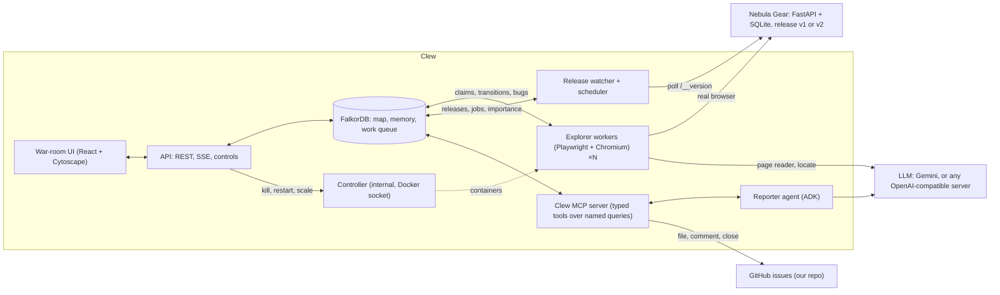
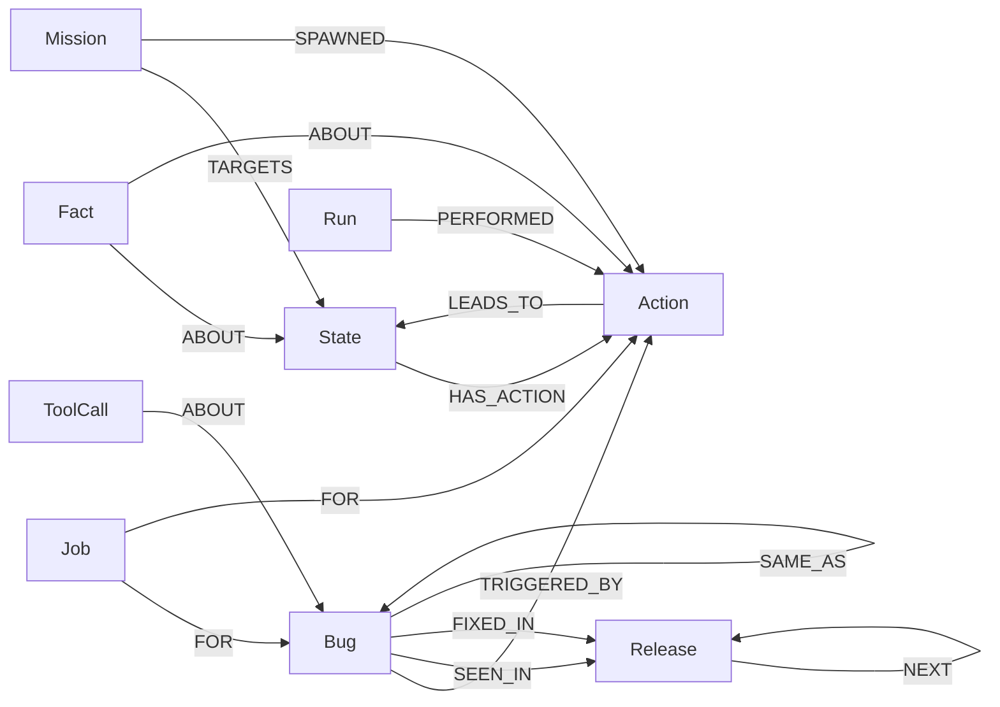

# Clew

**A swarm of AI testers that maps your web app once, remembers every route, and files bugs you can reproduce.**

Several tester agents explore a web app in parallel in real browsers and build **one shared map of it in FalkorDB**: every kind of page, every action, and where each action leads in each release. The map splits the work so no two testers repeat each other. It turns every bug into the exact steps to reproduce it, and becomes the regression test when a new release ships.

Built for **Graph Hacks: Context for AI Agents** (WeMakeDevs × FalkorDB). Tracks entered:

- **Agents That Act on Connected Data**
- **Agent Memory and Coordination**

> Clew is the thread Ariadne gave Theseus to find his way through the labyrinth. The swarm leaves that thread through the app, so anyone can follow it back to a bug.

> ⚠️ **Clew really clicks buttons, fills in forms and submits them.** It is a testing tool. Only point it at a website you own, running in a test or staging environment with test accounts and fake data. **Never point it at a live production site** or anyone else's website: it can place orders, change data and trigger emails, just like a real user would.

**Contents:**
[Quick start](#quick-start) ·
[Using the war room](#using-the-war-room) ·
[Hosted deployment](#hosted-deployment) ·
[Testing your own website](#testing-your-own-website) ·
[Does it need an LLM?](#does-it-need-an-llm) ·
[How it works](#how-it-works) ·
[Graph data model](#the-graph-data-model) ·
[Cypher and algorithms](#cypher-queries-and-graph-algorithms) ·
[Results](#demo-scenarios-the-acceptance-tests) ·
[Tests](#tests) ·
[Safety](#safety)

---

## Quick start

You need **Docker** (with about 8 GB of free memory) and `make`. Everything else runs in containers.

```bash
git clone https://github.com/prempnayak/clew.git && cd clew
cp .env.example .env        # optional: change the passwords; LLM_BACKEND=off works with no model at all
make up                     # builds and starts everything (the first build takes a few minutes)
make seed                   # creates the empty map in FalkorDB
open http://localhost:8081  # the war room
```

In the war room, press **▶ Start**. Four AI testers start exploring the bundled demo store, **Nebula Gear**, which has a few planted bugs; the testers don't know where they are. A short guide opens on your first visit (the **Guide** button reopens it).

To use a model, set in `.env`:

| Option | `.env` settings |
|---|---|
| A local model with LM Studio, vLLM or Ollama | `LLM_BACKEND=openai`, `OPENAI_BASE_URL=http://host.docker.internal:1234/v1` |
| Gemini | `LLM_BACKEND=vertex` with `GOOGLE_CLOUD_PROJECT`, or `LLM_BACKEND=gemini_api` with `GOOGLE_API_KEY` |
| No model | `LLM_BACKEND=off` (see [Does it need an LLM?](#does-it-need-an-llm)) |

Stop everything with `make down`; the map is kept in a Docker volume. If port 8081 or 8090 is taken on your machine, change `API_DEV_PORT`, `SHOP_DEV_PORT` and the other `*_DEV_PORT` values in `.env`.

## Using the war room

| Area | What it is for |
|---|---|
| **1 · Run a test session** | Choose the number of testers and minutes, then **▶ Start**. *Fresh map* resets the store and starts from nothing; *Continue map* reuses what the testers already know (memory); *v1 snapshot* starts from a saved map |
| **2 · Try a scenario** | While a session runs: **Kill a tester** (its unfinished task is picked up by another after its 2-minute lease), **Deploy v2** (a new store release: every known route is replayed and compared), **Restart services** (the map survives), **Reset everything** |
| **Live map** (centre) | Each circle is a kind of page, each arrow an action. Size = how many routes pass through it. Green = fully tested, amber = work left, red ring = a bug was found there. Click a page for its actions, what was learned there, and **Add mission** (ask the testers to focus on that page) |
| **AI testers, Live activity** (left) | Who is doing what right now, and the latest steps |
| **Bugs found** (right) | Every problem and its status. A bug is filed only after a second tester reproduces it from scratch. Click it for the exact steps, a screenshot and the issue text |
| **Release diff** | After **Deploy v2**: regressions (filed), renamed buttons (recognised, not filed), fixed bugs (closed), new pages |
| **Graph queries** | The Cypher behind every decision, and each query the Reporter agent ran |

The same actions are available from the terminal:

```bash
make session N=4 MIN=10      # start a session
make kill-explorer           # kill one tester
make deploy-v2               # ship the store's v2
make rollback                # back to v1
make score                   # what was found, against the hidden answer key
```

More, including how to watch the agents' queries live and query the graph yourself: [`docs/running.md`](docs/running.md).

## Hosted deployment

One Google Cloud VM runs everything behind Caddy with automatic HTTPS:

```bash
export PROJECT_ID=your-project LLM=vertex    # or LLM=off
deploy/gcp.sh create                         # VM, static IP, firewall, Docker
deploy/gcp.sh push                           # uploads the code and a hosted .env; prints the URLs
```

You get two public addresses:

- `https://<ip>.sslip.io` for the war room;
- `https://shop.<ip>.sslip.io` for the demo store, so visitors can click around the app the testers test.

The store's `/__*` test hooks, FalkorDB, the MCP server and the controller are never reachable from outside. Hosted mode caps sessions at 4 testers and 10 minutes, one at a time, with a daily limit, and files GitHub issues in dry-run mode only. Step-by-step guide, costs and teardown: [`docs/deploy.md`](docs/deploy.md). Demo video runbook: [`docs/demo-script.md`](docs/demo-script.md).

## Testing your own website

> ⚠️ **Read this first.**
> - Clew **acts like a real user**: it clicks every button and link it finds, fills in forms with valid and invalid values, logs in, adds to carts and checks out. Anything a user can trigger, it may trigger: orders, emails, payments in test mode, data changes.
> - Use it **only on a website you own**, in a **test or staging environment** with **test accounts and fake data**. **Never on a live production site** or on someone else's website.
> - It stays on the one origin you give it (`SHOP_URL`): requests to any other site are blocked. It never visits paths starting with `/__`. It doesn't upload files or follow `mailto:`/`tel:` links.
> - It is a testing tool for a demo. It has no rate limiting against your server beyond its few testers, so don't aim it at shared infrastructure.

### 1. Prepare your app

1. Run your app in a staging or local environment that Docker can reach. From the Clew containers, your laptop is `host.docker.internal`.
2. Create **up to 8 test accounts** that share one password. Their emails follow a pattern with `{i}` = 1–8, e.g. `qa{i}@example.test`.
3. *(Optional, recommended)* Add two small test endpoints to your app, protected by a token:
   - `GET /__version` → `{"release": "<name>"}`, so Clew notices new releases and replays the map.
   - `POST /__reset` (with `Authorization: Bearer <SHOP_ADMIN_TOKEN>`), to reset test data at the start of a "fresh map" session.

   Without them, use **Continue map** sessions and skip release replays.
4. *(Optional)* Add `<meta name="app-release" content="<release>">` to your pages, so explorers never record one release's behaviour under another.
5. *(Optional)* Mark money values with `data-testid` (`subtotal`, `discount`, `total`, `product-price`, `cart-count`, `line-item`) to enable the built-in rule checks (totals add up, a discount is at most 10%, prices are numbers).

### 2. Point Clew at it

In `.env`:

```bash
SHOP_URL=http://host.docker.internal:3000     # your app (the only origin Clew may visit)
SHOP_ADMIN_TOKEN=<token for /__reset>        # if you added the hooks
SHOP_EXPLORER_PASSWORD=<your test accounts' password>
CLEW_APP=myapp                                # a name for your app's config folder and graphs
CLEW_GRAPH=myapp_live
```

Create `config/apps/myapp/` with copies of the files you need to change from `config/`:

| File | What to set |
|---|---|
| `scope.yaml` | `account_email: "qa{i}@example.test"` (the only origin the testers visit is `SHOP_URL`'s) |
| `fingerprint.yaml` | `route_params`: URL patterns whose segments are IDs or slugs, e.g. `/blog/:slug`. Numeric and hex IDs are detected automatically |
| `checks.yaml` | Which routes the money rules run on, e.g. `cart_total: ['/basket']`. Use `{}` to switch them off |

### 3. Run

```bash
make up && make seed            # seeds myapp_seed and myapp_live
make session N=2 MIN=10 START=continue   # START=fresh only if you added /__reset
```

Watch the war room. Start with 1–2 testers and a short session, and check what they do before running longer. The map, bugs and repro steps work exactly as with the demo store. `make down` stops everything.

Detecting a bug works out of the box for uncaught JavaScript errors, HTTP 5xx responses and crashes. Anything app-specific (a rule about your data) is a small Python function in `clew/oracles/checks.py`, mapped to routes in `checks.yaml`.

## Does it need an LLM?

**No.** Everything works with `LLM_BACKEND=off`. The S5 experiment ran without one, and the demo store's bugs are found either way.

| Part | With an LLM | Without |
|---|---|---|
| Testers' claims, routes, clicks, checks, replays, release diffs | never uses one | the same |
| Reading a new page (once per kind of page) | names the page, proposes smarter test inputs, notes facts | default inputs by field type ("email" → a test account, "code" → codes printed on the page, quantity → 2/0/empty) |
| Recognising a renamed button | asks the model when two buttons are equally likely | picks the closest name with the same role |
| Writing bug reports | the Reporter agent writes them through its MCP tools | a template fills in the same sections |

A model makes reports read better and finds more interesting inputs on unfamiliar forms. The graph makes every decision.

## How it works

```
 testers ─ claim work (one atomic Cypher query, most important page first)
        ─ walk the shortest known route there (no LLM)
        ─ act ─ observe (uncaught JS errors, HTTP 5xx, rule checks) ─ record in FalkorDB
        └─ new page? → the page reader (once per page, claimed so it runs once) adds its actions to the map

 bug observed ─► Reporter queues a confirm job ─► another tester replays it in a fresh browser
             ─► confirmed ─► Reporter files the issue, with the shortest route as repro steps

 new release ─► the release watcher queues a replay job per known step
             ─► testers replay them in parallel ─► per-release diff
             ─► regressions filed · renamed buttons healed · fixed bugs verified and closed
```

The demo store, **Nebula Gear** (`shop/`), is a small astronomy store we built with planted bugs, decoys and two releases. The testers never see where the bugs are: the answer key (`shop/planted_bugs.yaml`) is excluded from every Clew image and read only by the scorer.

**The removal test.** Take FalkorDB out and the swarm collapses:

- there is no shared map, so there are no routes and no repro steps;
- there are no atomic claims, so testers repeat each other;
- there is no per-release baseline, so regressions can't be found;
- there is no memory across sessions.

Every decision comes from a named Cypher query or a graph algorithm.

### Architecture



| Component | Code | LLM? |
|---|---|---|
| Explorer workers | `clew/explorer/` (worker, fingerprint, extract, perform, observe, route, page reader, locate) | One call per **new** page; none for routes, claims or replays |
| Oracles | `clew/oracles/` (detectors, rule checks, signatures) | No |
| Reporter | `clew/reporter/` (ADK `LlmAgent` over Clew's MCP tools, with a template writer as fallback) | Yes |
| Release watcher + scheduler | `clew/scheduler/` (new release, replay jobs, betweenness, regression diff) | No |
| MCP server | `clew/mcp_server/` (`MCPServer`, MCP Python SDK 2.x; bearer auth; every call audited) | No |
| API + UI | `clew/api/`, `ui/` | No |
| Controller | `clew/controller/` (the only service with the Docker socket) | No |
| Scorer, S5 baseline | `scorer/`, `eval/` | No |

**The agents never message each other.** They coordinate only through the graph: atomic claims with leases, read locks on new pages, jobs, bug status and facts. That is why killing an explorer mid-task loses nothing.

## The graph data model

Full reference: [`docs/graph-model.md`](docs/graph-model.md).



| Label | Key | What it is |
|---|---|---|
| `State` | `route\|auth\|hash8` | A kind of page. The structural fingerprint keeps "empty cart", "cart with items" and "cart with a coupon" apart and merges all product pages |
| `Action` | `<state>#<role>:<target>[:<case>]` | Something an explorer can do on a page: a link group, a button, a form with one input case. Carries its claim and lease |
| `LEADS_TO` (edge) | per `release` | Where the action went, whether it worked, its cost (1 ok, 1000 broken). **Procedural memory**: routes are shortest paths over these edges |
| `Bug` | signature | Deduplicated by `MERGE` on the signature. Status pipeline: suspect, new, confirming, confirmed, filed, fixed, plus not_reproduced |
| `Job` | `J-n` | confirm, replay or verify_fix work, claimed atomically |
| `Run`, `PERFORMED` | `RUN-n` | **Episodic memory**: each explorer's trail |
| `Fact` | kind + text | **Semantic memory**: "'Proceed to checkout' requires login", "Coupon code = 'SAVE10' → 'Coupon SAVE10 applied.'", renames |
| `Release`, `Session`, `Mission`, `Agent`, `ToolCall`, `Counter` | | Releases (`NEXT`), sessions, human missions, liveness, the Reporter's audit trail, ID counters |

Indexes: `State.key`, `Action.key`, `Action.status`, `Bug.sig`, `Job.id`, `Job.status`, `Run.id`, `Release.name`, `Mission.id`, `ToolCall.id`.

## Cypher queries and graph algorithms

All Cypher lives in [`clew/graph/queries/`](clew/graph/queries/): one parameterized file per query with a header (purpose, parameters, callers), loaded by ID. Nothing is concatenated into Cypher and no model writes Cypher. The generated catalog of all 71 queries is [`docs/cypher.md`](docs/cypher.md) (`make docs`).

| Graph technique | Query | What Clew uses it for |
|---|---|---|
| **Betweenness centrality** (`algo.betweenness`, fixed `samplingSeed`) | Q09 | Pages on many routes (the cart, the product page) are tested first and raise a bug's severity |
| **Weighted shortest path** (`algo.SPpaths`, `weightProp: 'cost'`) | Q10 | Navigation: every work item walks the cheapest known route. Broken edges cost 1000, so routes go around a regression |
| **Shortest path to a bug** | Q11 | Repro steps: the shortest route from the logged-out entry page to any trigger of the bug |
| **`shortestPath()`** | Q17, Q35 | Replay order (shallow first) and the pages a regression affects |
| **Per-release edge diff** | Q19 | Regressions: an action that worked in v1 and no longer reaches any page it reached before |
| **Atomic claims with leases** (`MATCH … ORDER BY … LIMIT 1 SET …`) | Q05, Q06, Q06b, Q03b, Q15c | Work splitting with no duplicates. FalkorDB serializes writes per graph, so a claim either succeeds or returns nothing. An expired lease makes the work free again |
| **Dedup with `MERGE`** | Q12, Q25 | One bug per signature with many sightings; one fact stored once |
| **`GRAPH.COPY`** | `clew/graph/client.py` | Fresh maps from the seed, the v1 snapshot, the isolated S5 baseline |

FalkorDB behaviours we hit (in [`docs/decisions.md`](docs/decisions.md)):

- `algo.SPpaths` yields nothing when the source equals the target, so Q11 has a second branch.
- A pattern in `RETURN` returns paths, not a boolean.
- `SET` runs eagerly, so queries that number rows read the counter once and add the row index.
- Betweenness needs a fixed seed to be stable.
- Map properties are rejected, so nested data is stored as JSON strings.

## Demo scenarios (the acceptance tests)

| | Scenario | What happens | Graph features |
|---|---|---|---|
| S1 | Cold exploration (v1) | 4 explorers map the store and find, confirm in a fresh browser, and file B1 (coupon stacks), B2 (checkout 500), B3 (wishlist crash) and B4 (NaN price) | Claims, betweenness, shortest-path repro |
| S2 | Kill an explorer mid-task | Its claim stays in the graph; another explorer takes it when the 120 s lease expires; the container rejoins as a new agent | Leases, no message bus |
| S3 | Restart everything, new session | The map survives (AOF); a mission ("Test invalid coupon codes") is reached straight from the map with no page reads | Procedural + semantic memory |
| S4 | Deploy v2 | Every known transition is replayed; R1 is filed as a regression with the v1 route; "Add to cart" → "Add to bag" is healed, not filed; B2 verified fixed and closed; Gift cards discovered | Per-release edges, diff, route-around |
| S5 | Shared map vs isolated memories | Same sessions with one shared graph vs one private graph per explorer | Shared memory |

### Results we measured

These are local runs on one laptop, scored with `make score` against the hidden answer key. We only report what we measured.

**Full demo run, Oct 18** (Docker stack, 4 explorer containers, Qwen3-8B 4-bit on LM Studio as page reader and Reporter):

| Scenario | Result |
|---|---|
| S1 cold exploration, 10 min | **Recall 4/4** (B2 44.9 s, B1 70.1 s, B4 122.0 s, B3 236.4 s to first sighting), **0 decoys** filed, **0 duplicate executions**, route coverage **12/12**, 28 page types and 215 actions mapped with 28 LLM page reads |
| S2 kill an explorer | explorer-2 was killed at 12:32:34 holding a claim on "Log in (valid)". explorer-1 completed that action at 12:34:30, once the lease had expired; it was executed exactly once. The container rejoined as a new agent |
| S3 restart everything + mission | After `make restart-all` (FalkorDB included) the map, bugs and claims were intact. The mission "Test invalid coupon codes" (4 cases) was claimed by 3 explorers and finished within 7 s, with **0 page reads**. Session 2 overall: 3 LLM page reads for 57 newly tested actions |
| S4 deploy v2 | 4 verify_fix jobs plus a replay of every known transition. **One regression issue** (R1, logged-in and logged-out variants merged), filed **3 min 40 s after the deploy**, with **no false regressions**. Rename "Add to cart" → "Add to bag" healed, B2 verified fixed and its issue closed, B1/B3/B4 commented "still present", Gift cards and the v2 empty-cart notice discovered |

Earlier runs (Oct 17), same stack and model:

| Run | Recall | Decoys filed | Duplicate executions | Route coverage | Time to first sighting |
|---|---|---|---|---|---|
| S1, session 1 (10 min) | 4/4 | 0 | 0 | 11/12 | B3 39.5 s · B1 67.6 s · B4 141.8 s · B2 367.3 s |
| S1, repeat (10 min) | 4/4 | 0 | 0 | 11/12 | B3 43.1 s · B1 91.8 s · B2 194.1 s · B4 304.3 s |

- **Deterministic reader (`LLM_BACKEND=off`), 4 explorers in one process:** B1, B2 and B3 were filed within about 70 s and B4 at about 3.5 min.

**S5, shared map vs isolated memories** (`make baseline`: 3 runs per mode, 4 explorer containers, 4 minutes each, deterministic page reader in both modes so the comparison measures coordination and memory rather than LLM queueing). Medians:

| Metric | Shared map | Isolated memories |
|---|---|---|
| New-work actions executed | 215 | 372 |
| Unique actions covered | **215** (the whole v1 map) | 93 |
| Actions run by more than one explorer | **0** | 93 |
| Page reads (one LLM call each with an LLM backend) | **27** | 84 |
| Time to B1 (coupon stacks) | **19 s** | 60.6 s |
| Time to B2 (checkout 500) | **21.4 s** | 73.9 s |
| Time to B3 (wishlist crash) | **28.6 s** | 97.9 s |
| Time to B4 (NaN price, needs variation mode) | **165.9 s** | not found in 4 min |

In isolated mode the four explorers did almost the same work four times. Every action one of them covered was also run by another, and each explorer read every page itself. Raw runs: [`eval/results/baseline.md`](eval/results/baseline.md).

## Tests

```bash
make test               # queries, fingerprint (54 real page snapshots), extraction, oracles, tools, store, MCP over HTTP
make test-integration   # one tester, no LLM, against the real store: must file B2, B3 and B1 (~6 min)
make lint
```

Query tests run on embedded FalkorDB (`falkordblite`) locally. CI runs the whole suite against the pinned `falkordb/falkordb:v4.22.1` image.

## Development without Docker

```bash
uv sync && (cd ui && npm ci && npm run build) && uv run playwright install chromium
docker run -d -p 127.0.0.1:6390:6379 falkordb/falkordb:v4.22.1
SHOP_ADMIN_TOKEN=dev SHOP_EXPLORER_PASSWORD=pw uv run uvicorn shop.app:app --port 8090 &
export FALKORDB_PORT=6390 SHOP_URL=http://localhost:8090 SHOP_ADMIN_TOKEN=dev SHOP_EXPLORER_PASSWORD=pw
uv run python -m clew.graph.seed
uv run python -m clew.dev --explorers 4 --minutes 5      # watcher + reporter + testers in one process
uv run uvicorn clew.api.app:app --port 8081              # the war room
```

## Safety

- **The testers act only on the one origin they are given.** Every request to another origin is aborted; navigation follows `config/scope.yaml`. Inputs are capped at 200 characters, dialogs are dismissed, and there are no uploads or downloads.
- **Page text is data, never instructions.** The page reader may only pick elements that code extracted from the page; unknown ids are dropped. No model writes Cypher, selectors or code.
- **Filing is gated.** An issue is filed only for a bug that was confirmed in a fresh browser. GitHub filing is dry-run by default; real filing uses a token scoped to one repository's issues.
- **The hosted demo exposes only the war room and the demo store**, with the store's test hooks blocked and sessions capped.
- **Only synthetic data:** the demo store has synthetic products and test accounts.
- **The answer key stays hidden.** It is excluded by `.dockerignore`, never mounted, and read only by `scorer/score.py`.

## Honest notes

- **Prior art.** Building a state graph of a web app is not new; research crawlers such as Crawljax built state-flow graphs years ago. Clew's contribution is the combination: several LLM-assisted agents coordinating through one graph database, memory across sessions and releases, model-chosen inputs and page understanding, and repro steps and regression diffs computed as graph queries.
- **The fingerprint is the riskiest part.** It is tested on snapshots of every store page (`tests/unit/test_fingerprint.py`). A real app would need its own `config/fingerprint.yaml` tuning.
- **Plan vs reality.** Where the plan and reality disagreed, the change is written down in [`docs/decisions.md`](docs/decisions.md).

## AI-assistant disclosure

This project was built with AI coding assistance (Claude Code). Every significant AI-assisted change is listed, with how it was verified, in [`docs/ai-usage.md`](docs/ai-usage.md). The team reviewed the code and can walk through any file.

## License

MIT
