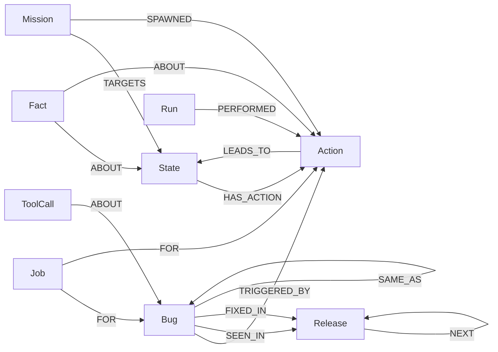

# Clew graph data model

One FalkorDB graph per environment: `nebula_seed` (App + Release v1, empty map), `nebula_live` (working map), `nebula_hosted` (judges), `nebula_v1_map` (snapshot of a full v1 map), `iso_<agent>` (S5 isolated baseline), `test_<uuid>` (tests). Reset = `GRAPH.DELETE` + `GRAPH.COPY nebula_seed <graph>`.

The graph has three jobs:

1. **The map of the app** (Track 1): pages as `State` nodes, actions as `Action` nodes, `LEADS_TO` edges per release.
2. **Memory** (Track 2): episodic (`Run`-`PERFORMED`), semantic (`Fact`), procedural (routes over `LEADS_TO`, repro paths, healed selectors).
3. **Coordination** (Track 2): claims and leases on `Action`, `State` (read locks), `Job` and `Bug` nodes. The agents never message each other.

## Nodes

| Label | Key | Main properties |
|---|---|---|
| `App` | `name` | `base_url` |
| `Release` | `name` | `deployed_at`, `current` |
| `Session` | `id` (S-n) | `release`, `mode` (shared, isolated), `explorers`, `minutes`, `start_from`, `started_at`, `ended_at`, `status`, `summary` (JSON) |
| `State` | `key` = `route\|auth\|hash8` | `route`, `auth` (in, out), `fingerprint`, `name`, `url_example`, `entry`, `first_seen`, `first_seen_by`, `last_seen`, `visits`, `importance` (betweenness), `read`, `read_by`, `read_at` (read lock), `elements` (JSON: the extracted candidates) |
| `Action` | `key` = `<state key>#<role>:<target>[:<case>]` | `state_key`, `label`, `role`, `name`, `by`, `selector` (JSON), `kind` (click, fill_submit), `input_case`, `inputs` (JSON), `instance_policy` (first, round_robin), `next_instance`, `status` (untried, claimed, done, skipped), `skip_reason`, `claimed_by`, `claimed_at` (lease), `tries`, `last_result`, `priority`, `origin` (page_reader, strategist, mission), `aliases` (old names after a heal), `healed_at`, `variations`, `varied_by`, `varied_at`, `created_at` |
| `Bug` | `sig` (one format per kind, below) | `kind`, `title`, `severity` (P1–P3), `status` (suspect, new, confirming, confirmed, filed, not_reproduced, fixed), `first_seen`, `last_seen`, `count`, `release_found`, `evidence` (JSON), `issue_number`, `issue_url`, `issue_title`, `issue_body`, `filed_at`, `fixed_at`, `report_by`, `report_at` (Reporter lease), `reported_status`, `needs_comment` |
| `Job` | `id` (J-n) | `kind` (confirm, replay, verify_fix), `status` (queued, claimed, done, failed), `target`, `release`, `priority`, `payload`, `claimed_by`, `claimed_at` (lease), `attempts`, `result`, `created_at`, `finished_at` |
| `Run` | `id` (RUN-n) | `agent`, `session`, `release`, `started_at`, `steps`, `llm_calls` |
| `Fact` | `id` (MERGE on `kind` + `text`) | `kind` (precondition, input, rename, note), `text`, `created_by`, `at`, `release` |
| `Agent` | `name` | `role`, `model`, `session`, `state`, `current_work`, `last_seen` |
| `Mission` | `id` (M-n) | `text`, `status`, `created_by`, `created_at` |
| `ToolCall` | `id` | `tool`, `agent`, `args` (JSON), `query_ids`, `trace` (JSON: each query's id, parameters, first rows), `ms`, `ok`, `at`, `summary` |
| `Counter` | `name` | `v` (job, mission, session, run, issue) |

## Relationships

| Pattern | Properties | Meaning |
|---|---|---|
| `(State)-[:HAS_ACTION]->(Action)` | `cost` = 0 | The page offers this action |
| `(Action)-[:LEADS_TO]->(State)` | `release`, `ok`, `error`, `ms`, `cost` (1 ok, 1000 broken), `at`, `by`, `seen` | What the action did in each release. Routes are weighted shortest paths over these edges |
| `(Bug)-[:TRIGGERED_BY]->(Action)` | | One bug, possibly several triggers; the cheapest route wins as repro steps |
| `(Bug)-[:SEEN_IN]->(Release)`, `(Bug)-[:FIXED_IN]->(Release)` | | Bug history across releases |
| `(Bug)-[:SAME_AS]->(Bug)` | `reason`, `at` | The Reporter merged a look-alike |
| `(Job)-[:FOR]->(Bug or Action)` | | What a job is about |
| `(Run)-[:PERFORMED]->(Action)` | `n`, `at`, `ok`, `ms`, `kind` (explore, mission, variation, confirm, replay, verify_fix), `instance` (JSON) | Episodic memory: each explorer's trail |
| `(Fact)-[:ABOUT]->(State or Action)` | | Semantic memory |
| `(Mission)-[:TARGETS]->(State)`, `(Mission)-[:SPAWNED]->(Action)` | | Human or Strategist test requests |
| `(Release)-[:NEXT]->(Release)` | | Release order |
| `(ToolCall)-[:ABOUT]->(Bug)` | | Audit trail of the Reporter's tool calls |

## Indexes (Q01)

`State.key`, `Action.key`, `Action.status`, `Bug.sig`, `Job.id`, `Job.status`, `Run.id`, `Release.name`, `Mission.id`, `ToolCall.id`.

## Keys and signatures

- **State key** `route|auth|hash8`: the route with id-like segments as `:id` and query keys only; `in` if a log-out control is on the page; the first 8 hex characters of the SHA-1 of the structural tokens of `main` (headings by level, interactive roles without names, collections as empty/some). See `clew/explorer/fingerprint.py` and `config/fingerprint.yaml`.
- **Action key** `<state key>#<role>:<target>[:<case>]`: the target is the route pattern for links, the normalized name for buttons, the field names for forms.
- **Bug signatures**:
  - `http_5xx|<METHOD> <route>|<status>`
  - `pageerror|<route>|<normalized message>`
  - `console_error|<route>|<normalized message>`
  - `rule|<rule id>|<route>|<hash8>`
  - `regression|<route>|<hash8>#<role:target>`
  - `nav_timeout|<state key>|<action key>`

  Rule and regression signatures leave out the auth part, so the same page seen logged in and out is one bug.

## Conventions

- Times are epoch milliseconds passed in as `$now`.
- Nested data is stored as JSON strings: FalkorDB rejects map properties.
- `SET` runs eagerly, so queries that number several rows read the counter once and add the row index (Q17, Q18).
- `shortestPath()` only appears in `WITH`/`RETURN`. Betweenness always runs with a fixed `samplingSeed` (Q09).
- Leases come from `config/session.yaml`: actions 120 s, jobs 180 s, page reads 60 s, Reporter claims 120 s. An expired claim is free work for anyone, so no cleanup process exists.
